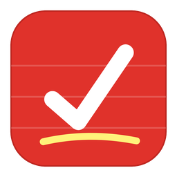
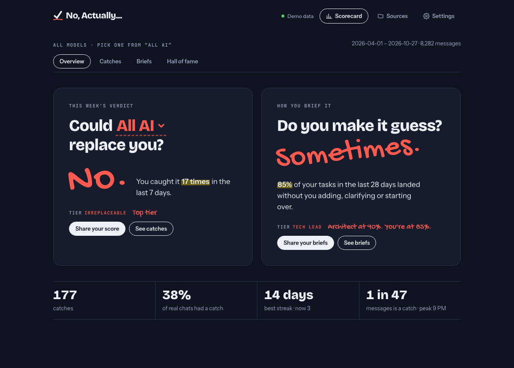
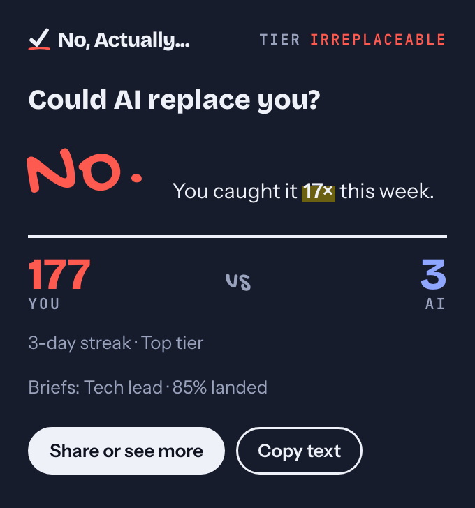

<p align="center">
  
</p>

<h1 align="center">No, Actually...</h1>

<p align="center">
  <b>Could AI replace you? No, actually.</b><br>
  A private, local-first scorecard that counts the times you caught your AI being wrong.
</p>

<p align="center">
  <a href="https://github.com/HTMLGuyLLC/NoActually/actions/workflows/ci.yml"></a>
  <a href="LICENSE"></a>
  
  
  
</p>

<p align="center">
  <a href="https://github.com/HTMLGuyLLC/NoActually/releases/latest"></a><br>
  <sub>Free and open source · <a href="#download-and-install">How to install</a></sub>
</p>

<p align="center">
  
</p>

---

You correct your AI all day: the function that doesn't exist, the instruction it ignored, the bug that's "fixed" but still broken. **No, Actually...** reads your chat history on your own computer, finds those moments with fixed rules, and turns them into a score you can be proud of.

## Features

- **A verdict, every week.** "Could Claude replace you? No. You caught it 17 times." Tiers run from Rubber stamp up to Irreplaceable.
- **How you brief it.** A second verdict, "Do you make it guess?", from how many of your tasks landed without you adding to, clarifying or redoing them. It shows what your briefs carry (a file, an error, what done looks like, limits, the why), where steering went, and one tip. Tiers run from Vibes only up to Architect.
- **Every model, side by side.** See catches for all AI, one provider, one family, or one exact version (say, Claude Opus 5.5), with a searchable picker.
- **Lives in your menu bar.** A quick glance on click, a full scorecard window, and a popup when you hit your 10th catch, a new tier (catches or briefs), or a streak.
- **A Hall of Fame.** Your best catches, kept as redacted snippets. Pin the ones you want to keep forever.
- **Made to share.** One dialog for X, LinkedIn, Facebook, Threads, Bluesky, Reddit, WhatsApp and Instagram, plus share card images. You always see exactly what will be posted.
- **History and live tracking.** It backfills what's already on disk (files are read in parallel), then follows new chats as they happen.

<p align="center">
  
</p>

## Private by design

| | |
|---|---|
| **Asks first** | Nothing is read until you click **Allow** on a source. Pause, stop, or **Forget** (delete everything from it) any time. |
| **Stays on your machine** | No accounts, no servers, no telemetry. The only network use is an update check against GitHub (no identifiers, can be turned off) and opening a share link you click. Fonts are bundled. |
| **Stores numbers, not chats** | Ordinary messages are only counted. For catches you choose **full text**, **snippet**, or **category only**, and text steps down on a timer you set. |
| **Redacts** | Keys, emails, links, paths and long numbers are removed from anything kept. |

The details are in [PRIVACY.md](PRIVACY.md).

## How a catch is counted

No AI judges your chats. The same history always gives the same score, and every rule is readable in [`crates/engine/src/rules.rs`](crates/engine/src/rules.rs).

| Label | Rule |
|---|---|
| **Confirmed** | You push back **and** the AI admits the mistake |
| **Admitted** | The AI's next reply opens with "you're right", "good catch", "my mistake"… |
| **Claimed** | Your message opens with "no, that…", "still not working", "you missed"… (not when you're answering its question) |
| **Humbled** | The AI corrects *you* ("Actually…", "Not quite") |

Adding context ("also", "fyi", "I forgot to mention") never counts against the AI. Each catch is charged to the model that wrote the reply you corrected.

## How a brief is graded

Same rules: no AI, deterministic, readable in [`crates/engine/src/brief.rs`](crates/engine/src/brief.rs).

- **A task** starts with a chat's first message, or a later one that opens with "now…", "next:", "new task". Hellos, "continue" and questions ("what does this do?") aren't tasks.
- **A brief's grade** counts what it carries, never its length: **points at it** (a file, function, link, `code`), **shows it** (an error, output, an example, anything pasted), **says what done is** (expected result, tests, a format), **sets limits** (don't, only, keep, without), **says why** (the goal or context). Three or more is **sharp**, two is **solid**, fewer is **thin**. Pasted blocks count as showing it, but their words aren't graded as yours.
- **Steering** is a later message that redirects the task: a catch (the AI got it wrong), or one that's on you: **added more** ("also…", "I forgot to mention"), **clarified** ("I meant…", "to be clear"), or **started over** ("scrap that", "revert it").
- **A task landed** when nothing on you followed it. Only tasks with a follow-up count: a one-shot task can't need steering. The tier is the share that landed over the last 28 days (at least 10 such tasks): Vibes only, Ticket writer 70%+, Tech lead 80%+, Architect 90%+. The AI being wrong never counts against you; that's a catch.

The tip names the thing your briefs carry least. It only quotes "briefs that do landed X% vs Y%" when your own history shows a real gap. On the author's history, longer briefs didn't steer less: bigger tasks get both longer briefs and more back-and-forth. Published studies don't show that link either.

**Where the numbers come from.** There's no public benchmark for weekly per-person scores, so every threshold was checked three ways: the author's history (8,600 messages), a random sample of 3,400 English chats from [WildChat-1M](https://huggingface.co/datasets/allenai/WildChat-1M) run through these exact rules, and published figures (Claude Code users interrupt in 5–9% of turns; in multi-turn developer chats, 14–17% of prompts refine the request).
- The catch rate per message agrees across sources (1 in 47 for the author, 1 in 41 in WildChat).
- Public chats are short and almost never steer, so the brief floors come from one heavy user. A typical month there was 86% (Tech lead).
- Expect the brief floors to move once more people's numbers exist.

## Supported tools

| Tool | How |
|---|---|
| Claude Code | Live |
| Claude Cowork | Live |
| Codex (CLI and desktop) | Live |
| ChatGPT | Import your data export |
| Claude.ai | Import your data export |

Coming: Gemini CLI, Ollama, Open WebUI, LM Studio, VS Code Copilot, Cursor and Aider, plus a browser extension for live ChatGPT, Claude.ai and Gemini. Want one sooner? [Request it](https://github.com/HTMLGuyLLC/NoActually/issues/new/choose), or add it yourself: an adapter is about 100 lines plus a test (see [CONTRIBUTING.md](CONTRIBUTING.md#add-a-source-adapter)).

## Download and install

1. Open the **[latest release](https://github.com/HTMLGuyLLC/NoActually/releases/latest)**.
2. Scroll to **Assets** at the bottom of that page. If you only see a few items, click **Assets** (or "Show all assets") to expand the list.
3. Download the one file for your computer:

| Your computer | Download | Install |
|---|---|---|
| **Mac** (macOS 12 or newer, Apple silicon or Intel) | `No-Actually-<version>-Mac.dmg` | Open it, drag **No, Actually...** into **Applications**, then open it from there. It's signed and notarized by Apple, so it opens with no warnings. |
| **Windows** | `No-Actually-<version>-Windows-Setup.exe` | Run it. If you see "Windows protected your PC", click **More info → Run anyway** (the Windows build isn't code-signed yet). |
| **Linux** | `No-Actually-<version>-Linux.AppImage` | Right-click → Properties → allow it to run as a program (or `chmod +x`), then open it. |

Not sure which Mac you have? It doesn't matter: the Mac download works on every Mac that runs macOS 12 or newer.

The other files are for special cases:
- `-Windows-IT-Installer.msi` is for IT teams deploying to many PCs.
- `-Linux-Ubuntu-Debian.deb` and `-Linux-Fedora.rpm` install through your Linux package manager.
- `SHA256SUMS.txt` lets you verify a download.

**On first launch,** click **Choose sources**, then **Allow** the AI tools you want counted. Nothing is read until you do. After that the app lives in your menu bar (Mac) or system tray (Windows and Linux).

### Build from source

For developers. Needs Rust stable, Node 20+ and pnpm:

```bash
git clone https://github.com/HTMLGuyLLC/NoActually.git
cd NoActually/app && pnpm install && pnpm tauri build -c '{"bundle":{"createUpdaterArtifacts":false}}'
```

The app lands in `target/release/bundle/`. (The `-c` part skips the signed update files, which need the project's private key.) To run it in development instead, use `pnpm tauri dev`.

### Command line

The same engine and database also work from a terminal:

```bash
cargo run --release -p noactually-cli -- sources              # what it can read, and what you've allowed
cargo run --release -p noactually-cli -- allow claude-code
cargo run --release -p noactually-cli -- sync
cargo run --release -p noactually-cli -- stats --family "Claude Opus"
```

Set `NOACTUALLY_DB=/path/to/test.db` to use a different database than your real one. See [docs/ARCHITECTURE.md](docs/ARCHITECTURE.md#command-line) for every command.

## How it's built

```
crates/engine    the rules, model names and redaction: pure Rust, no I/O, WASM-ready
crates/sources   one adapter per AI tool (Claude Code, Codex, exports…)
crates/store     SQLite: consent, checkpoints, daily counts, retention, rules versioning
crates/cli       the `noactually` command
app/             Tauri 2 desktop app: menu bar, scorecard window, notifications
```

Highlights:
- **Crash-safe checkpoints.** A turn is only counted once its reply exists, and every file's writes commit in a single transaction.
- **Hashed message keys.** Resumed sessions, forks and re-imports are never counted twice.
- **Rules versioning.** When the rules change, scores are rebuilt from history. Pinned catches are always kept; other history counts again only if its files still exist.

The full design is in [docs/ARCHITECTURE.md](docs/ARCHITECTURE.md).

## Contributing

Issues and PRs are welcome. Good places to start:
- Support for another AI tool
- A rule that miscounted one of your chats (use the **Wrong catch** form, and redact the text first)
- Polish on the app

Read [CONTRIBUTING.md](CONTRIBUTING.md), then run the same checks as CI with [just](https://github.com/casey/just) (`brew install just` or `cargo install just`):

```bash
just ci
```

Without `just`, run these from a fresh clone. The frontend must be built first because the app crate reads `app/dist` at compile time:

```bash
pnpm --dir app install --frozen-lockfile
pnpm --dir app build
cargo fmt --all --check
cargo clippy --workspace --all-targets -- -D warnings
cargo test --workspace
pnpm --dir app check
pnpm --dir app lint
pnpm --dir app test
node --test scripts/*.test.mjs
```

You can try the UI in a browser on sample data with `cd app && pnpm dev`, then open http://localhost:1420.

## History

The first version was a Python prototype. It was replaced by the Rust engine, and the original is preserved at the git tag `prototype-v0`. The roadmap and what scoring means are in [docs/PRODUCT.md](docs/PRODUCT.md).

## License

[MIT](LICENSE) © HTMLGuy LLC
