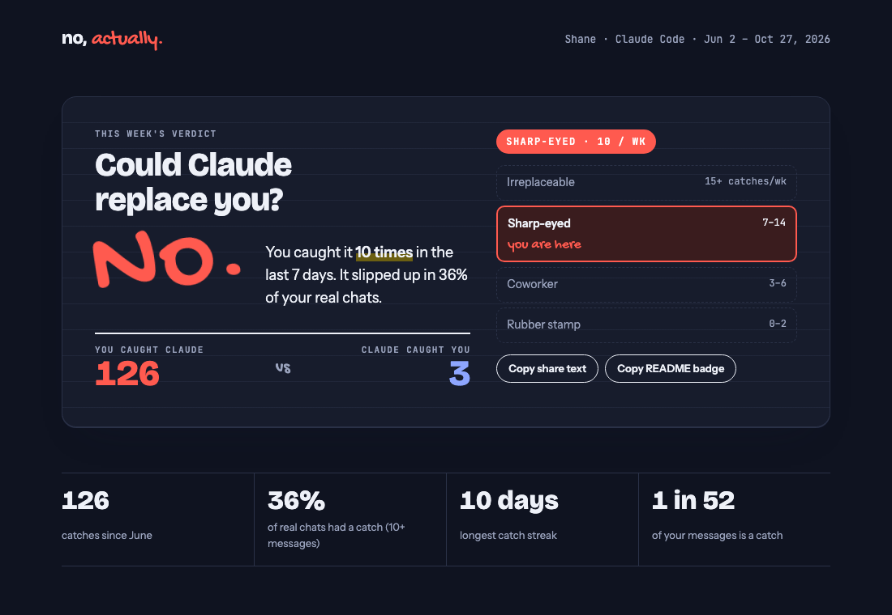

# No, Actually

**Could AI replace you? No, actually: you caught it 177 times.**

No, Actually reads your AI chat history on your computer, finds the moments you caught the AI being wrong, and turns them into a score, a model-by-model breakdown, and a card you can share. It lives in your menu bar: a quick glance on click, a full scorecard window, and a popup when you hit a milestone.

- **Private by default.** Nothing is read until you allow a source. Ordinary messages are only counted, never stored. You choose how much catch text to keep (full, snippet, or category only), and it steps down on a timer you set.
- **Deterministic.** No AI judges your chats. Fixed, readable rules give the same score every time.
- **Fast.** A first backfill of ~1,700 history files takes about 6 seconds, and live updates read only new bytes.
- **Shareable.** One click saves a share card and copies a brag line. Numbers only, never your chats.



The app's UI also runs in a plain browser on sample data: `cd app && pnpm dev`, then open http://localhost:1420.

## Supported tools

| Tool | How |
|---|---|
| Claude Code | Live |
| Claude Cowork | Live |
| Codex (CLI + desktop) | Live |
| ChatGPT | Import your data export |
| Claude.ai | Import your data export |

Gemini CLI, Ollama, Open WebUI, LM Studio, VS Code Copilot, Cursor, Aider and a browser extension for live ChatGPT/Claude.ai/Gemini are planned. See [docs/ARCHITECTURE.md](docs/ARCHITECTURE.md#sources).

## How a catch is counted

| Label | Rule |
|---|---|
| Confirmed | You push back **and** the AI admits the mistake |
| Admitted | The AI's next reply opens with "you're right", "good catch", "my mistake"… |
| Claimed | Your message opens with "no, that…", "still not working", "you missed"… (not when you're answering its question) |
| Humbled | The AI corrects *you* ("Actually…", "Not quite") |

Adding context ("also", "fyi", "I forgot to mention") never counts against the AI. A catch is charged to the model that wrote the reply you corrected. Every rule lives in [`crates/engine/src/rules.rs`](crates/engine/src/rules.rs) with tests.

## Layout

```
crates/engine    rules, model names, redaction (pure, no I/O)
crates/sources   one adapter per AI tool
crates/store     SQLite: consent, checkpoints, daily counts, retention
crates/cli       `noactually` command
app/             Tauri 2 desktop app (menu bar + window)
prototype/       the original Python experiment
docs/            product, architecture, sample scorecard
```

## Run it

Needs Rust (stable) and Node 20+ with pnpm.

```bash
cd app && pnpm install && pnpm tauri dev
```

Or the CLI:

```bash
cargo run --release -p noactually-cli -- sources
cargo run --release -p noactually-cli -- allow claude-code
cargo run --release -p noactually-cli -- sync
cargo run --release -p noactually-cli -- stats --family "Claude Opus"
```

Checks (the same ones CI runs):

```bash
cargo fmt --all --check
cargo clippy --workspace --all-targets -- -D warnings
cargo test --workspace
pnpm --dir app check && pnpm --dir app test
```

Build an installable app (unsigned unless signing secrets are set):

```bash
cd app && pnpm tauri build
```

See [CONTRIBUTING.md](CONTRIBUTING.md) to add a tool or change a rule, and [PRIVACY.md](PRIVACY.md) for exactly what is stored.

## License

[MIT](LICENSE)
